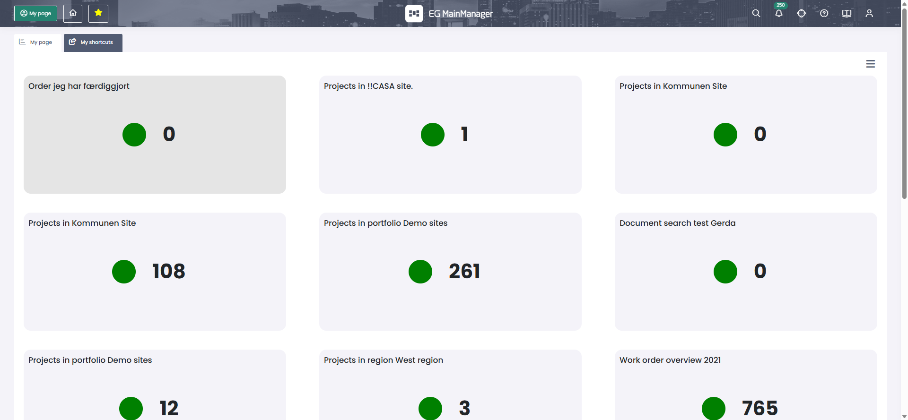
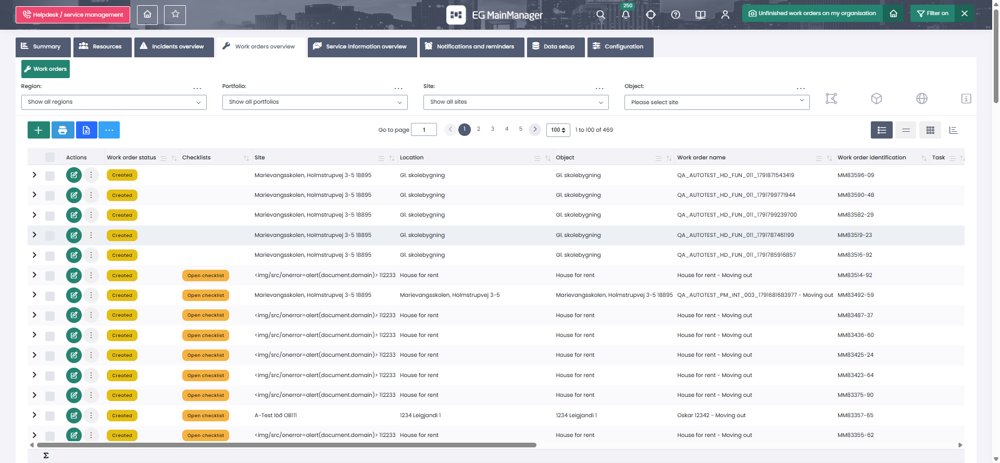

# Capture log — Kommune Scenario 1

Every request below was recorded in a real Chrome session on
**kommune.mainmanager.is (v20.26.1)** on **13 October 2026**, signed in as a standard
user. Method: hook `XMLHttpRequest.prototype.open/send`, clear the log, perform
**one** step by hand, dump the log. One step at a time — that is what makes the
attribution unambiguous.

```js
// Pasted into the Console once, before step 2.
window.__net = [];
const ox = XMLHttpRequest.prototype.open, os = XMLHttpRequest.prototype.send;
XMLHttpRequest.prototype.open = function (m, u) { this.__m = m; this.__u = u; return ox.apply(this, arguments); };
XMLHttpRequest.prototype.send = function (b) {
  const t0 = performance.now();
  const rec = { m: this.__m, u: String(this.__u), req: b, st: null, ms: null, bytes: null, res: null };
  this.addEventListener('load', function () {
    rec.st = this.status; rec.ms = Math.round(performance.now() - t0);
    rec.bytes = this.responseText.length; rec.res = this.responseText.slice(0, 400);
  });
  window.__net.push(rec);
  return os.apply(this, arguments);
};
// Before each step:  window.__net = []; performance.clearResourceTimings();
```

Static files (CSS, JS, images, fonts) were counted via
`performance.getEntriesByType('resource')` and then **dropped** — a browser caches
them, so replaying them would measure a file server rather than the application.

---

## Step 1 — Login

> *Enter your username and password, click Login*

`GET /mmv2/MMV2Login.aspx` → read `__VIEWSTATE`, `__VIEWSTATEGENERATOR`,
`__EVENTVALIDATION` → `POST` them back with the credentials → **302** →
`GET /mmv2/MMV2Content.aspx` (6,960 ms).

**44 requests total**: 31 xhr, 5 css, 4 script, 2 link, 1 img.

| # | Endpoint | ms | Bytes | In script? |
|---|---|---|---|---|
| 1 | `MMLayoutReadOnly.asmx/IsNewUser` | 1,274 | 11 | no — welcome-tour flag |
| 2 | `restapi/internal/GetHeaderLogo` | 334 | 2 | no — branding |
| 3 | `restapi/Internal/KeepAlive` | 330 | 4 | no — timer heartbeat |
| 4 | `MMLayoutReadOnly.asmx/BuildMainMenu` | 596 | 26,457 | **yes** |
| 5 | `MMLayoutReadOnly.asmx/GetUnreadCount` | 399 | 171 | **yes** |
| 6–23 | `GetMenuItemSteps`, 3× `saveToggleValue`, `InitMainLayout`, `BuildMyPage`, 18× `InitPortalAggregate` | — | — | no — the **restored module**, see below |
| 24–25 | `signalr/negotiate`, `signalr/start` | 1,778 / 323 | 392 / 25 | no — push channel |

**The restored module.** After login the app reopens whatever module the account last
viewed — here My page, so a full dashboard load fired before the user did anything.
The script does **not** replay it: it depends on what somebody last clicked, which
would make runs non-reproducible. Consequence, stated plainly: the script understates
the server cost of a login by roughly one module load.

---

## Step 2 — Select module My page

> *Select module My page* → "Module and tabs open and shows data as expected"

Opening the navigation menu first fired **0 requests** — it is pure client-side; the
menu was already downloaded by `BuildMainMenu`. Clicking **My page** fired:

**25 requests. Every one an API call. No static files at all.**

| # | Endpoint | Request body | ms | Bytes |
|---|---|---|---|---|
| 1 | `saveToggleValue` | `{"MySection":"ActiveDataStateV2","MyKey":"ActiveNavigationItem","Value":"MyPage"}` | 321 | 8 |
| 2 | `GetMenuItemSteps` | `{"Tag":"MyPage"}` | 335 | 8,223 |
| 3 | `saveToggleValue` | `…"MyKey":"ActiveNavigationItem","Value":"MyPage"` | 359 | 8 |
| 4 | `saveToggleValue` | `…"MyKey":"ActiveNavigationStepMyPage","Value":"MainSummary-2147483643"` | 360 | 8 |
| 5 | `saveToggleValue` | `…"MyKey":"ActiveNavigationStepItemMyPage.MainSummary-2147483643","Value":"MainSummary-2147483643"` | 358 | 8 |
| 6 | `MMLayout.asmx/InitMainLayout` | `{"UniqueString":"","MenuItemKey":"MainSummary-2147483643","SummaryID":2147483643,"MenuItemID":0,"MenuItemTypeID":2,"ProcessTag":"MyPage","ProcessStepTag":"MainSummary-2147483643","SnapshotID":0}` | 360 | 2,685 |
| 7 | `BuildMyPage` | `{"MainSummaryID":2147483643,"FilterValues":""}` | 376 | 35,742 |
| 8–25 | **18× `InitPortalAggregate`**, concurrent | `{"PortalKey":"Snapshot-4390","MainModuleID":883,"ExcludeLocation":false,"Checksum":"lf6VxRunmSpf8IiIv+A8wdj9VcrPNTtXZQVyDa/1Gzg="}` …and 17 more | 813–2,752 | 233–264 each |

The 18 widget keys, in fire order:

```
Snapshot-4390  Snapshot-4394  Snapshot-4393  Snapshot-4392  Snapshot-4391
Snapshot-4385  Snapshot-4388  Snapshot-4389  Snapshot-3225  Snapshot-4273
Snapshot-4270  Snapshot-4282  Snapshot-4281  Snapshot-4264  Snapshot-4275
Snapshot-4280  Snapshot-4279  Snapshot-3226
```

Note **Snapshot-4270** — that is the widget clicked in step 3.

**Why the four 8-byte `saveToggleValue` calls are in the script.** They record which
module/tab/sub-tab is active server-side. `BuildMyPage` returns an **empty** dashboard
on a repeat navigation without them, and the filter endpoints — session-scoped —
accept calls with `200` but bind to nothing. They look like noise; they are not.

**Why `http.batch`.** The browser fires all 18 concurrently. A serial loop would
spread the same database work over ~18 seconds and measure something the application
never does.



---

## Step 3 — Click "Unfinished work orders on my organisation"

> "Module and tab Helpdesk < Work orders opens and shows data as expected"

The widget tile read **469**. **14 requests.**

The first call is the interesting one. `SelectSnapshotFromMyPage` **tells us where we
are going** — we did not have to guess:

```json
POST MMLayoutReadOnly.asmx/SelectSnapshotFromMyPage   {"SnapshotID":4270}

{"d":{"__type":"Iceconsult.MainTools.xMMMenuItem",
      "Caption":"Work orders",
      "Key":"Request",
      "Path":"Helpdesk.Request.Request",
      "ParentKey":"Request",
      "GrandParentKey":"Helpdesk", …}}
```

That is where `processTag: 'Helpdesk'`, `dataTag: 'Request'` and the grid's
`DataPath Request$1$0` in the script come from. Work orders live under **Helpdesk**,
not Operation and maintenance.

| # | Endpoint | Request body | ms | Bytes |
|---|---|---|---|---|
| 1 | `SelectSnapshotFromMyPage` | `{"SnapshotID":4270}` | 386 | 1,158 |
| 2 | `saveToggleValue` | `…"ActiveNavigationItem","Value":"Helpdesk"` | 323 | 8 |
| 3 | `GetMenuItemSteps` | `{"Tag":"Helpdesk"}` | 571 | 36,852 |
| 4 | `GetMenuItemProcessItems` | `{"Parent":"Helpdesk","Tag":"Request"}` | 413 | 1,336 |
| 5 | `GetMenuItemProcessItems` | *identical — sent twice, 70 ms apart* | 340 | 1,336 |
| 6 | `saveToggleValue` | `…"ActiveNavigationItem","Value":"Helpdesk"` | 340 | 8 |
| 7 | `saveToggleValue` | `…"ActiveNavigationStepHelpdesk","Value":"Request"` | 1,321 | 8 |
| 8 | `saveToggleValue` | `…"ActiveNavigationStepItemHelpdesk.Request","Value":"Request"` | 337 | 8 |
| 9 | `InitMainLayout` | `{"UniqueString":"","MenuItemKey":"Request","SummaryID":0,`**`"MenuItemID":1143`**`,"MenuItemTypeID":1,"ProcessTag":"Helpdesk","ProcessStepTag":"Request","SnapshotID":0}` | 1,103 | 7,735 |
| 10 | `LoadMMFilterControl` | `{tag:'Request', type:'3'}` — top Region/Portfolio/Site bar | 373 | 40,560 |
| 11 | `LoadMMFilterControl` | `{tag:'Request', type:'2'}` — right-hand panel | 467 | **214,111** |
| 12 | `BuildLayout` | the layout container, echoed back | 334 | 13,192 |
| 13 | `GET restapi/List/GetMMListHeaders` | `?DataPath=Request$1$0&UniqueString=bf15594c…&Gantt=False&PopupSQLListIndex=0` | 957 | 3,973 |
| 14 | `POST restapi/List/GetMMList` | DataTables form payload | **1,686** | **588,707** |

`GetMMList` response:

```json
{"draw":1,"recordsTotal":469,"recordsFiltered":469,
 "columnSums":[…],
 "data":[[83596, …
```

**469 rows**, first row id **83596** — matching the widget tile exactly. That
agreement is how you know the snapshot scope applied rather than the grid loading
unfiltered.

Two things worth noting for their own sake: `LoadMMFilterControl` type 2 returns
**214 KB** of filter markup every time the grid opens, whether the user touches a
filter or not; and `GetMMList` at 588 KB / 1.7 s is the heaviest call in the journey
and the first thing that will break under load.



---

## Step 4 — Go back, select module My page

> "Module and tabs open and shows data as expected"

**25 requests — byte-identical to step 2.** Same sequence, same bodies, same 18
widgets. This is why the script uses one `stepMyPage()` function for both.

---

## Step 5 — Logout

> *Click logout*

Opening the user-settings dropdown fired **0 requests** (client-side, verified). The
Logout link's `href` is literally `MMV2Logout.aspx`:

```
GET /mmv2/MMV2Logout.aspx  →  302  →  /mmv2/MMV2Login.aspx
```

---

## Totals

| Step | Action | Requests | Kept | Heaviest call |
|---|---|---:|---:|---|
| 1 | Login | 44 | 4 | `BuildMainMenu`, 26 KB |
| — | Open the navigation menu | 0 | 0 | — |
| 2 | Select module My page | 25 | 25 | 18× `InitPortalAggregate` |
| 3 | Click the widget | 14 | 14 | `GetMMList`, 588 KB / 1.7 s |
| 4 | Back to My page | 25 | 25 | 18× `InitPortalAggregate` |
| 5 | Logout | 1 | 1 | — |

---

## Values this capture pinned down

| Constant | Value | Where it came from | Per tenant? |
|---|---|---|---|
| `MYPAGE_SUMMARY_ID` | `2147483643` | `InitMainLayout` body, step 2 | product sentinel (`int.MaxValue - 4`); confirm once |
| `WIDGET_SNAPSHOT_ID` | `4270` | `SelectSnapshotFromMyPage` body, step 3 | **yes — always re-capture** |
| `menuItemId` | `1143` | `InitMainLayout` body, step 3 | **yes** |
| `processTag` / `dataTag` | `Helpdesk` / `Request` | `SelectSnapshotFromMyPage` **response** | yes |
| `dataPath` | `Request$1$0` | `GetMMListHeaders` query string | follows `<dataTag>$1$0` |
| grid page size | `100` | `GetMMList` `length=` | varies per grid |
